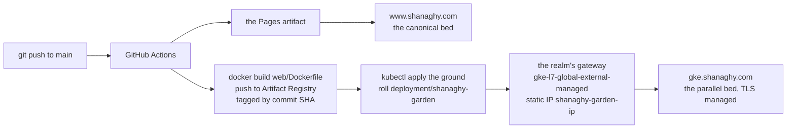

# shanaghy.com — Hosting & Publishing Design

What this is: a hosting platform for random session publishing and other random
stuff. A convention-driven static site that any machine in the agent fleet
(cork, hal-9005, the Mac, any mossy) can publish to with nothing but git.

The garden grows in `web/` — a Next.js static export. `git push` to `main`
is the entire CMS: GitHub Actions builds the garden once and serves it on
two beds — GitHub Pages at `www.shanaghy.com`, the canonical bed, and GKE
Autopilot at `gke.shanaghy.com`, the parallel bed on the fleet's cluster
ground beside the fenrir-ledger halls.

---

## 1. Repo layout

    web/                    the garden — everything below ships
      content/              page bodies (creed, laws, profiles, projects,
                            sessions, sites, videos, index…)
        garden.json         the living garden's souls — every entity the
                            /garden/ scene displays; grown, not drawn
      pages/                one route per page; owns title + meta description
      public/              shipped verbatim into the build output
        CNAME               shanaghy.com — must match the Pages setting
        robots.txt, sitemap.xml, favicon.svg, assets/
      lib/                  ContentPage.js — the one source of truth for
                            header, footer, nav on every page
      styles/               page css
      Dockerfile           the garden's container — node builds the export,
                            nginx serves it, unprivileged on port 8080
      nginx.conf            the serving rules: trailing-slash canonical,
                            404.html, /healthz for the probes
    infrastructure/k8s/     the cluster ground — namespace, deployment,
                            service, gateway, httproutes
    .github/workflows/deploy.yml      the Pages pipeline — canonical www
    .github/workflows/deploy-gke.yml  the GKE pipeline — image build, push,
                            and roll on every merge to main
    data/                   catalogs for The Sync (projects, videos, profiles)
    scripts/gen_sitemap.py  regenerates web/public/sitemap.xml + robots.txt
                            from web/pages + web/content; run when routes change
    scripts/gen_garden.py   renders the living-garden scene SVG between the
                            garden-scene markers in web/content/garden.html
                            from web/content/garden.json; run when souls change
    HOSTING.md              this doc

There is no second static layer. If a file isn't under `web/`, `data/`, or
`scripts/`, it doesn't ship.

---

## 2. Hosting: GitHub Pages (via Actions)

`.github/workflows/deploy.yml` on every push to `main`:

1. `npm ci && npm run build` in `web/` (Next static export → `web/out/`)
2. the built 404 page copied to `web/out/404.html`; `.nojekyll` touched
3. `web/out` uploaded as the Pages artifact and deployed

Why Pages:

- **Agent-friendly publishing.** The entire CMS is `git push`. No API tokens
  for a hosted service, no dashboard, no upload step. Anything that can commit
  can publish — which is exactly the fleet's capability set.
- **Free TLS.** GitHub provisions and renews the cert for the custom domain.
- **Zero maintenance.** No server to babysit. cork stays free for actual
  dynamic workloads.

What Pages can't do — no server-side anything, no API of its own — stays
that way.

### Escape hatch: cork

If something needs to be dynamic (API, search, webhooks, a small app), it does
**not** move the site. Instead, run the service on cork (192.168.1.3, Linux,
docker/portainer) and expose it on a subdomain:

- **Cloudflare Tunnel** (preferred): outbound-only connection from cork, no
  port forwarding, no home-IP exposure, works behind NAT. `api.shanaghy.com`
  or similar points at the tunnel, not at Pages.
- **Caddy** as a reverse proxy on cork, if DNS is ever moved somewhere that
  points a subdomain directly at the house.

Pages keeps serving `www`/apex content forever; subdomains are a separate
problem with a separate, cheap solution. This split is deliberate.

---

## 3. Hosting: the GKE parallel bed

`gke.shanaghy.com` — the same garden on the fleet's cluster ground, in the
`fenrir-ledger-prod` project beside fenrirledger.com and say-so.world.
`.github/workflows/deploy-gke.yml` on every merge to `main` (when `web/`
or the manifests change):

1. builds `web/Dockerfile` — node builds the static export, nginx serves
   it — and pushes it to Artifact Registry tagged with the commit SHA:
   `us-central1-docker.pkg.dev/fenrir-ledger-prod/shanaghy-images/shanaghy-garden`
2. applies the manifests in `infrastructure/k8s/shanaghy-garden/` to the
   `fenrir-autopilot` cluster: namespace, deployment, service, gateway,
   httproutes
3. rolls the deployment to the new image and waits for the rollout

The ground:

- GKE Autopilot cluster `fenrir-autopilot` (us-central1)
- a global static IP `shanaghy-garden-ip` fronts the
  `gke-l7-global-external-managed` gateway; GKE auto-provisions the
  managed TLS cert for the route's hostname once DNS points at the gateway
- CI authenticates by Workload Identity Federation — the `shanaghy-com`
  OIDC provider in the `github-actions` pool trusts this repo's GitHub
  Actions tokens, granted `artifactregistry.writer` on the repo and
  `container.developer` on the project; no keys in repo secrets
- http only redirects to https; the garden answers on https, canonical
  trailing slashes served by the nginx rules in `web/nginx.conf`

DNS for the parallel bed, at the registrar (shanaghy.com's DNS lives at
Namecheap — the zone is not in GCP):

    gke  A  <the shanaghy-garden-ip address>

The managed cert provisions itself once the record resolves; until then
the deployment answers cluster-locally (`kubectl -n shanaghy-garden
port-forward deploy/shanaghy-garden 8080`) and the http listener answers
with its redirect.

One-time ground setup (gcloud, already stood):

    gcloud artifacts repositories create shanaghy-images \
      --repository-format=docker --location=us-central1 --project=fenrir-ledger-prod
    gcloud compute addresses create shanaghy-garden-ip --global \
      --project=fenrir-ledger-prod
    gcloud iam workload-identity-pools providers create-oidc shanaghy-com \
      --workload-identity-pool=github-actions --location=global \
      --issuer-uri="https://token.actions.githubusercontent.com" \
      --attribute-mapping="google.subject=assertion.sub,attribute.repository=assertion.repository" \
      --attribute-condition="assertion.repository == 'declanshanaghy/shanaghy.com'" \
      --project=fenrir-ledger-prod
    gcloud artifacts repositories add-iam-policy-binding shanaghy-images \
      --location=us-central1 --project=fenrir-ledger-prod \
      --member="principalSet://iam.googleapis.com/projects/317218387675/locations/global/workloadIdentityPools/github-actions/attribute.repository/declanshanaghy/shanaghy.com" \
      --role="roles/artifactregistry.writer"
    gcloud projects add-iam-policy-binding fenrir-ledger-prod \
      --member="principalSet://iam.googleapis.com/projects/317218387675/locations/global/workloadIdentityPools/github-actions/attribute.repository/declanshanaghy/shanaghy.com" \
      --role="roles/container.developer"

---

## 4. DNS setup

At the registrar (or wherever shanaghy.com's DNS lives). GitHub Pages'
documented addresses:

Apex (`shanaghy.com`) — four A records:

    185.199.108.153
    185.199.109.153
    185.199.110.153
    185.199.111.153

and four AAAA records:

    2606:50c0:8000::153
    2606:50c0:8001::153
    2606:50c0:8002::153
    2606:50c0:8003::153

`www` — CNAME:

    www  CNAME  declanshanaghy.github.io

The canonical name is `www.shanaghy.com` (apex 301s to it). The same name
sits in repo Settings → Pages → Custom domain and in `web/public/CNAME`
(one line, the bare domain) — the two must match or each deploy
un-configures the other.

After DNS propagates, wait for GitHub to issue the cert, then enable
**Enforce HTTPS**.

Notes:

- If DNS moves behind Cloudflare later, set the Pages records to
  **DNS-only (grey cloud)** — proxying breaks GitHub's cert validation.
- Subdomains — cork services and the `gke` bed — are their own records;
  they never touch the apex/www records.

---

## 5. Agent workflow

1. Clone once per machine:
   `git clone git@github.com:declanshanaghy/shanaghy.com.git`
   — or HTTPS with a credential helper. Repo-scoped deploy keys or a
   fine-grained PAT with `contents: write` on this repo only. No
   fleet-wide tokens.
2. Publish: add or edit a page body under `web/content/` and its route
   under `web/pages/` (sessions land in `web/content/sessions/`, filed by
   project bed). New pages need a route file and an index/card entry where
   the bed has one.
3. Commit, message style: **lowercase, `site:` prefix, imperative**, e.g.

       site: add session the-ballad-of-many-mossys
       site: tweak creed meta tags

4. Build locally before pushing — `npm ci && npm run build` in `web/` —
   and assert the built page in `web/out/` carries what you meant
   (law 10: what is generated is asserted).
5. `git pull --rebase` then `git push` to `main`. Don't force-push main;
   don't rework other machines' files. Actions deploys in about a minute —
   verify at the live URL before reporting done.

Concurrent publishes from multiple machines are fine as long as everyone
rebases before pushing.
